# Assignment h5 Alice and Bob

# x) Read and summarize (with some bullet points)

 Schneier 2015: [Applied Cryptography](https://learning.oreilly.com/library/view/applied-cryptography-protocols/9781119096726/),\
Chapter 1 – Foundations, [Terminology](https://learning.oreilly.com/library/view/applied-cryptography-protocols/9781119096726/08_chap01.html#chap01-sec001)
-----------------------------------------------------------------------------------------------------------------------------------------------------------

- A sender wants to get a message to a receiver without an eavesdropper being able to read it.

- Plaintext is encrypted into ciphertext and decrypted back again

- Cryptography should also provide authentication (who really sent it), integrity (it wasn't changed) and nonrepudiation (the sender can't deny sending it).

- Relying on a hidden algorithm is weak. Modern systems put all the security in a key, so the algorithm can be published, reviewed and widely used.

- Cryptosystem is an algorithm together with all its possible plaintexts, ciphertexts and keys.

- **Synchronous encryption**: The same key is used to encrypt and decrypt, so both sides must agree on it beforehand and keep it secret. They come as stream ciphers (bit by bit) or block ciphers (chunks of bits).

- **Asynchronous encryption**: They use two different keys, and the private key can't feasibly be worked out from the public one. Anyone can encrypt with the public key, but only the private key holder can decrypt. Used in reverse, the same idea gives digital signatures.

### Chapter 2 - Protocol Building Blocks, sections, [2.5 Communications Using Public-Key Cryptography ](https://learning.oreilly.com/library/view/applied-cryptography-protocols/9781119096726/10_chap02.html#chap02-sec005)

- Public-key crypto works like a mailbox: anyone can put mail in, but only the owner can take it out.

- No secret key has to be shared in advance.

- Public-key crypto is slow, so it's mainly used to send a random session key.

- That session key then encrypts the actual messages quickly (a hybrid system).

- A digital signature is made with your private key and checked with your public key.

- People usually sign a short hash of the document, not the whole document.

- Timestamps stop signed documents from being reused, and a signer can't easily deny signing.

## Karvinen 2023: [PGP - Send Encrypted and Signed Message - gpg](https://terokarvinen.com/2023/pgp-encrypt-sign-verify/)

This is a Linux command-line tutorial on using PGP (gpg) to send private messages over the internet. You lock a message with the recipient's public key so only they can read it, and sign it with your own secret key so they know it's really from you. The article practices this with a fictional Alice sending an encrypted, signed message to Tero.

- **Use:** Encryption keeps the message unreadable to outsiders, and signing proves who sent it and that it wasn't altered. Public keys let two people establish trust without meeting.

- Alice (simulated with a separate folder and gpg --homedir .) sends a message to Tero on one Linux machine. It was tested on Debian 12.

- gpg --gen-key creates each keypair. The secret key must stay private, and the public key can be shared openly. The demo uses empty passphrases, which isn't advisable for real keys.

- gpg --export --armor --output writes the public key as ASCII text, and gpg --import loads the other person's key.

- **Verifying keys:** Both sides compare fingerprints over a separate channel, such as a phone call, then run gpg --sign-key to mark the key as trusted. This check is what stops someone swapping in a fake key.

- **Encrypting and signing:** Alice runs gpg --encrypt --recipient \<email\> --sign --armor --output encrypted.pgp message.txt. Only Tero's secret key can decrypt the result, not even Alice's.

- **Sending:** The armored file can travel over an untrusted network such as email, since it is useless without Tero's secret key.

- **Receiving:** gpg --decrypt encrypted.pgp shows the message and a "Good signature" line, confirming it came from Alice.

- **Troubleshooting:** If key generation fails with an agent_genkey error, run killall gpg-agent. A "No public key" error means you haven't imported that key or used the wrong fingerprint.

# a)How am I using public key cryptography today:

**Mostly using HTTPS sites,** such as [https://login.salesforce.com/,](https://login.salesforce.com/) and for nearly every website, app and email check in my day-to-day tasks.

**Parties and how each uses keys:**

1.  **Certificate authority (CA)** signs the website's certificate with its **private key**. The certificate binds the site's name (e.g. salesforce.com) to the site's public key.

2.  **my browser or operating system** ships with the **public keys** of trusted CAs. When I connect, it uses the CA's public key to verify the signature on the site's certificate, which tells it the public key really belongs to that site.

3.  **Web server** holds a **private key** that never leaves it. During the handshake it uses this key to sign proof that it is the real owner of the certificate.

4.  **My browser, again** uses the public key in the certificate to verify that signature. It also takes part in a key exchange so both sides agree on a fresh shared secret without sending it over the network.

5.  **Both sides, after the handshake** switch to fast **symmetric** using that shared secret for the actual page data. Public key cryptography is used only to establish trust and agree on the key.

**Other examples where I surely use public keys are:**

- **SSH:** a server's host key and your key pair, if you log in to servers.

- **Software updates:** the vendor signs packages with a private key, and your device checks them with the vendor's public key.

- **Messaging apps ( WhatsApp):** each user has key pairs used to set up end-to-end encryption.

- **Nordea Finnish online banking system:** Surely public key techniques are used behind the scenes for authentication and signatures.

> **<u>Reference</u>:** Claude AI prompted to help with this part.

## b)Encrypt and decrypt a message

I Am using Linux Debian 13 and gpg comes pre-installed with it so I did not need to instal any encryption tool.\
I just double checked that the gpg is installed bay saying: gpg --version.

b)1- One time setup\
- I/ Creating my key pair:\
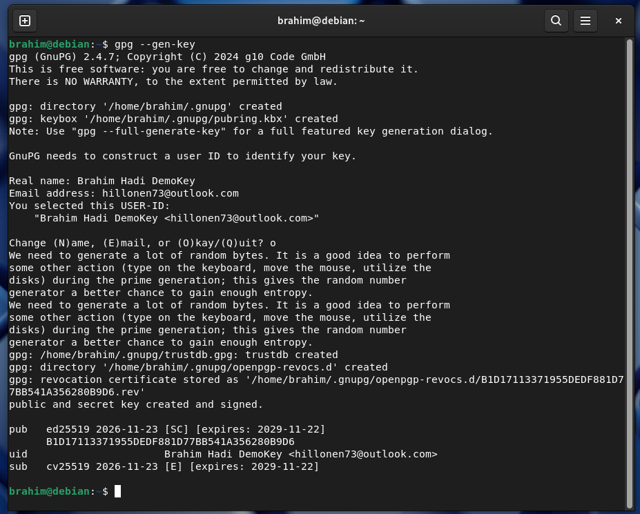

## - Export My Public Key to share

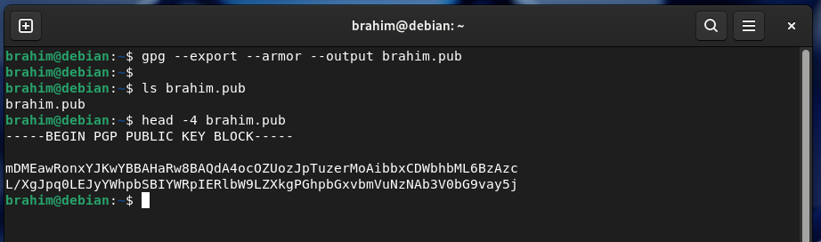

**- Adam User simulated in a different directory\**
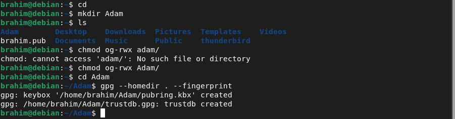

**- Adam creating own keypair (basically the same steps as in I/ step )\**
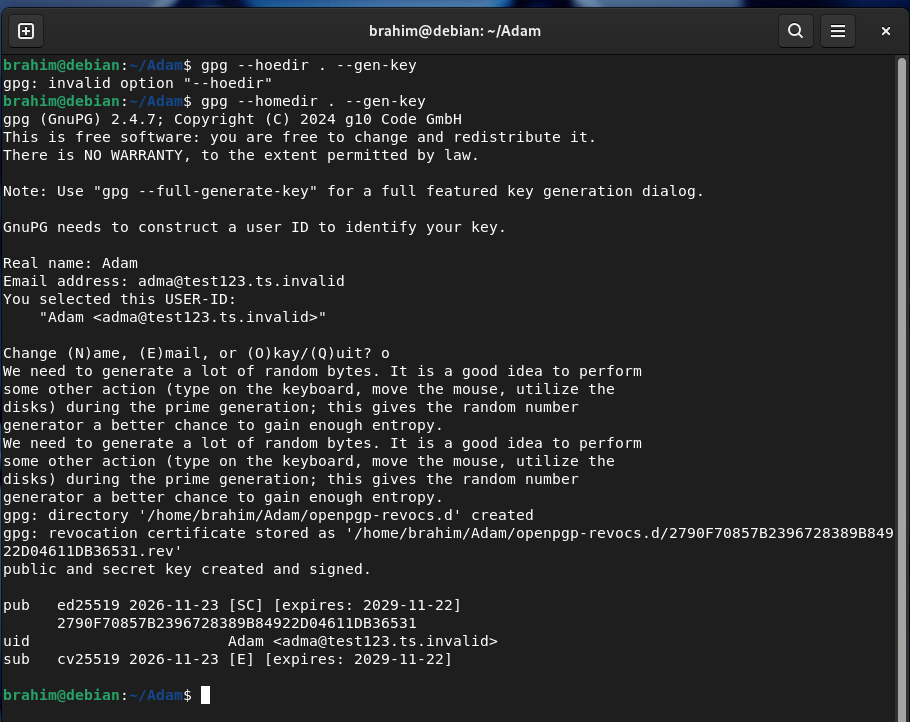

**- Adam Imports and Verifies Brahim's key**

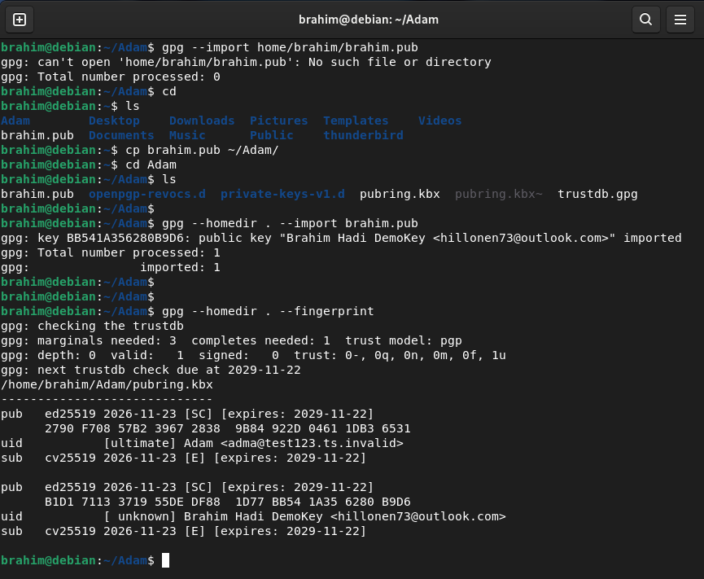

**- Showing the trust\**
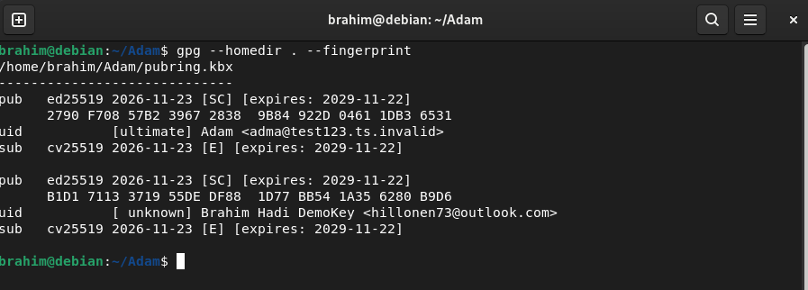**\
- Adam exports the public key file and Brahim imports it:\**
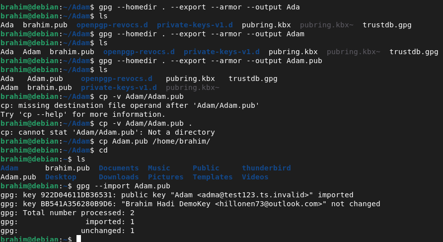

**- Brahim signs the Key and the trust is established between Brahim and Adam:\**
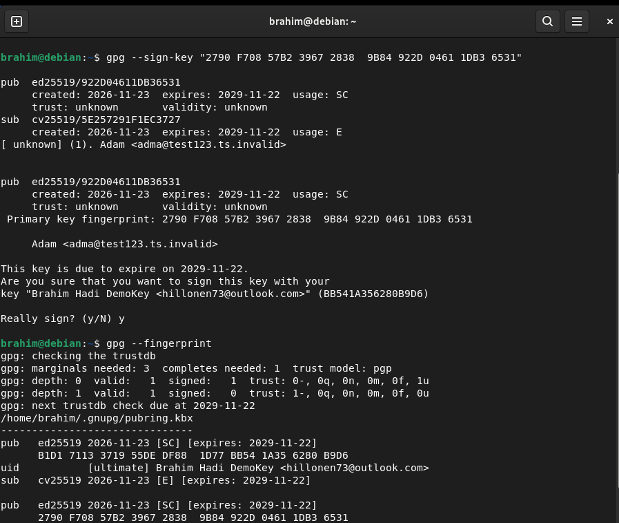

b)2- Adam creates a Secret Message to Brahim and signs it and encrypts it:**\**
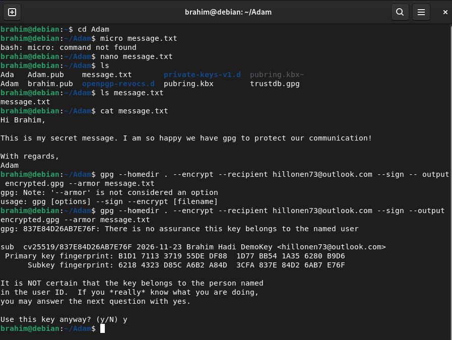

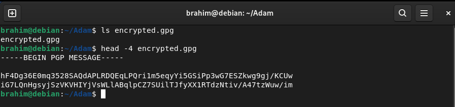

- **\
  Simulate the transfer by copying the encrypted file to Brahim directory:\**
  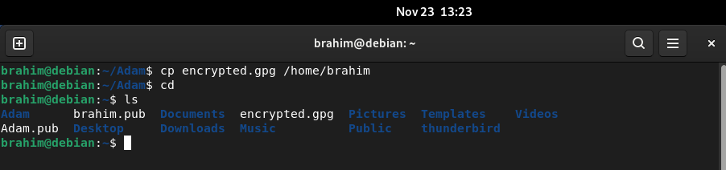

> **- Brahim Decrypts and Verifies the Message**
>
> **gpg: decrypt_message failed: unknown system error**
>
> 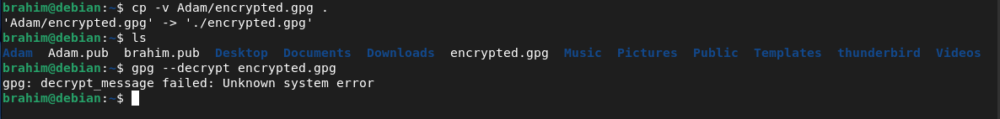
>
> Running the command: ***killall gpg-agent*** did not help.\
> Most probably something went wrong during secret message encryption. So I will redo the steps from message encryption again and see if it will solve the issue.
>
> 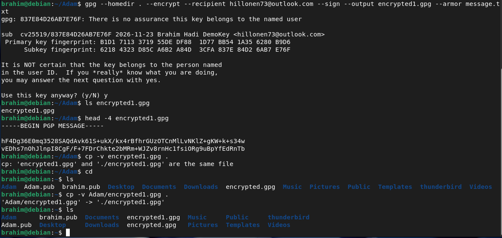

**\**

> **Decrypt the encrypted1.pgp file and Verifies the Message:**
>
> This time decrypting the message was successful with Brahim’s secret key and Brahim can read Adam’s encrypted message. 😊**\**
> 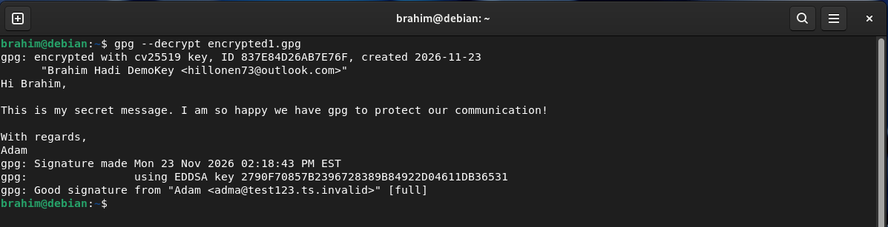**\**
> Adam's signature was verified using Adam's public key. Now Brahim knows it's really him.
>
> gpg: Good signature from "Adam \<adma@test123.ts.invalid\>" \[full\]

c\) Typical KeePassXC setup\
Here is a Ttypical KeePassXC setup and how I am using it daily:

**1. Create the database. Done it only once.**

- *Database → New Database* creates a .kdbx file. It is encrypted and protected by a key derivation function (Argon2), which makes guessing the master password slow.

- Set one long master password. It's the only one I memorize.

- I Save the file somewhere I back up.

**2. I Add an entry**

- *Entries → Add New Entry*, then fill in title, username and URL.

- Click the dice icon next to the password field to generate a random password, e.g. 24+ characters. I never need to see or remember it. It is not memorisable anyway.

**3. Log in**

- I usually copy the username and the pw to the website I am trying to login.

- **Copy:** copying a password to the clipboard clears it after a short timeout (10 seconds by default).

**4. Extras**

- I set the database to be locked after 4 min of no activity (auto-lock timer).

## Attacks that might exploit people not using password management tool: 

| **Attack Type** | **How** |
|----|----|
| **Phishing** | A fake login page on a lookalike domain (salesf0rce-login.com) collects your credentials |
| **Credential stuffing** | Passwords leaked from one site are tried on many others |
| **Password spraying** | Attackers try a few very common passwords (Summer2026!) across many accounts |
| **Shoulder surfing** | Someone watches you type |
| **Password-pattern guessing** | Attackers guess variations of your known passwords (Pass1, Pass2) |

\
-
