# H4 assignment Feed me – Brahim Hadi \\#a1504665

# X) Why would you want to use a feed reader (and RSS/Atom)

A feed reader (also called an RSS reader) is an app that gathers new posts from all your favorite websites into one place, so you don't have to visit each site to check for updates.\
How it works

1.  Many websites publish a feed, a simple behind-the-scenes list of their latest articles, usually in a format called RSS or Atom.

2.  You give the feed reader the addresses of sites you like, such as news sites, blogs or podcasts. This is called "subscribing."

3.  The reader checks those feeds regularly and shows you every new post in one list, a bit like an email inbox for websites.

### Why people like it

- Everything in one place: You check one app instead of twenty websites.

- You're in control: You see every post from the sites you chose, in order, with no algorithm deciding what you get.

- No ads, no distractions: Many readers show the article cleanly, without the site's clutter.

- Private: You don't need an account on each site, and nothing tracks what you click the way social media feeds do.

Ref. <https://feeder.co/knowledge-base/rss-basics/rss-feed-reader-what-is-it-and-how-does-it-work/>

y\) Supreme court of Finland, [case Osuuspankkikeskus port scan KKO:2003:36](https://www.finlex.fi/fi/oikeuskaytanto/korkein-oikeus/ennakkopaatokset/2003/36)

## Case summary:

- A 17-year-old used a program to scan the systems of Osuuspankkikeskus, looking for open proxy servers. The scan didn’t get through the bank’s firewall.

- The Supreme Court held that a port scan like this counts as **attempted computer break-in** (*tietomurron yritys*), even though nothing was actually accessed.

- The lower courts had disagreed: the district court threw out that charge, and the appeals court convicted. The Supreme Court said that breaking into a system requires no special purpose or motive, and that his scan was capable of breaking into a system.

- The young boy had to pay the bank’s costs. The court refused to reduce the damages despite his age and financial situation. Its reasons were that information security matters a great deal, that the act was intentional, and that it didn’t matter that he didn’t know the target was this particular bank.

## 1- Installing Thunderbird Feed Reader in Linux Debian 13:

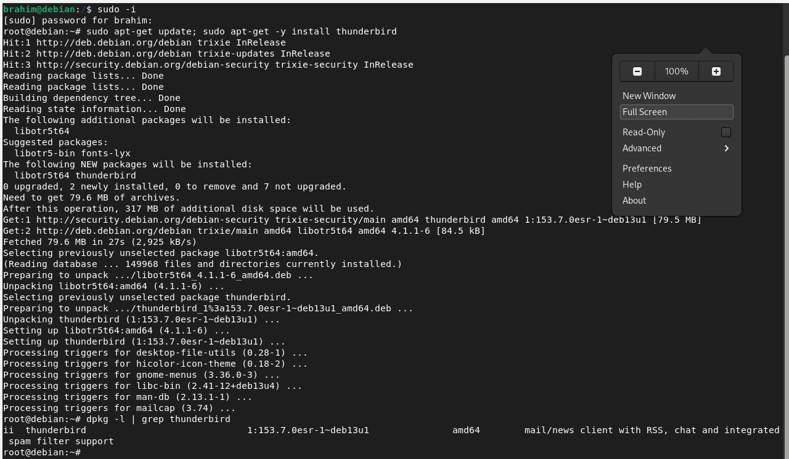

### 2- Installing Thunderbird Feed Reader in windows:

1.  Go to [**https://www.thunderbird.net**](https://www.thunderbird.net).

2.  Click **Download**. It automatically picks the right version for Windows and your language.

3.  Open the downloaded Thunderbird Setup x.x.exe file.

4.  If Windows asks “Do you want to allow this app to make changes?”, click **Yes**.

5.  Choose **Standard** installation and click **Next**, then **Install**, then **Finish**.

6.  Thunderbird opens and asks you to set up your email account. Enter your name, email address and password, and it usually finds the server settings automatically.

    1)  Create a feed account:\
        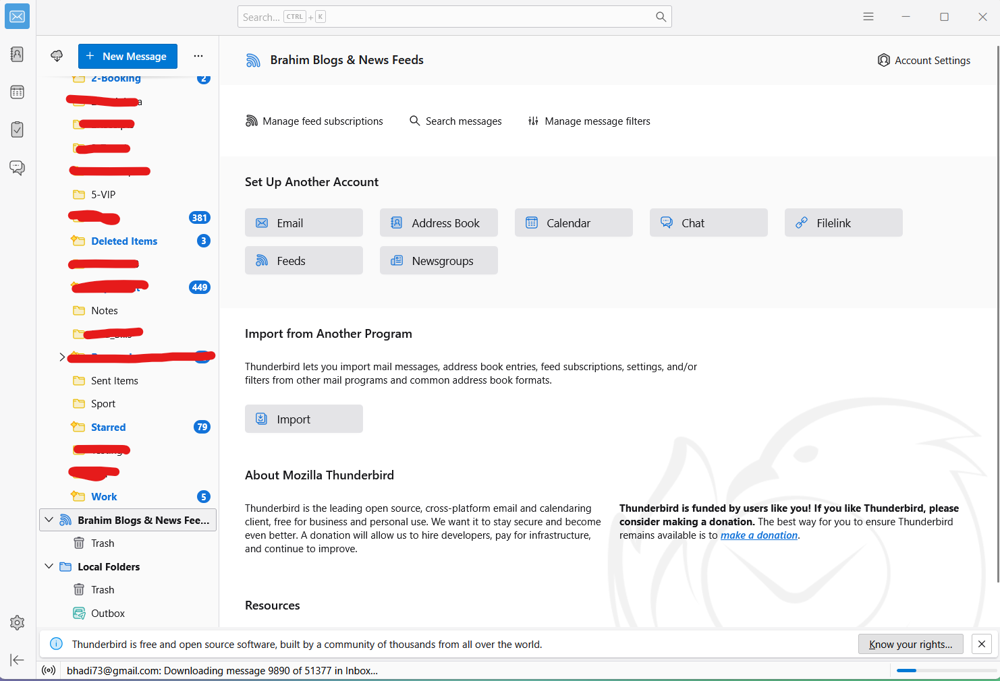

    2)  Add a feed for Krebs:\
        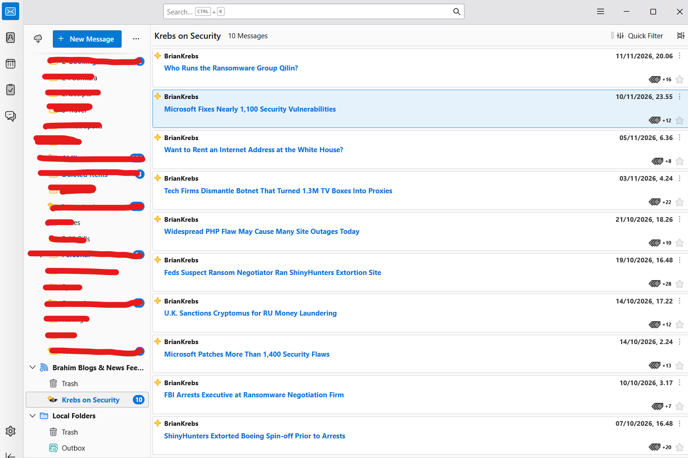

### Add a feed for Schneier on Security

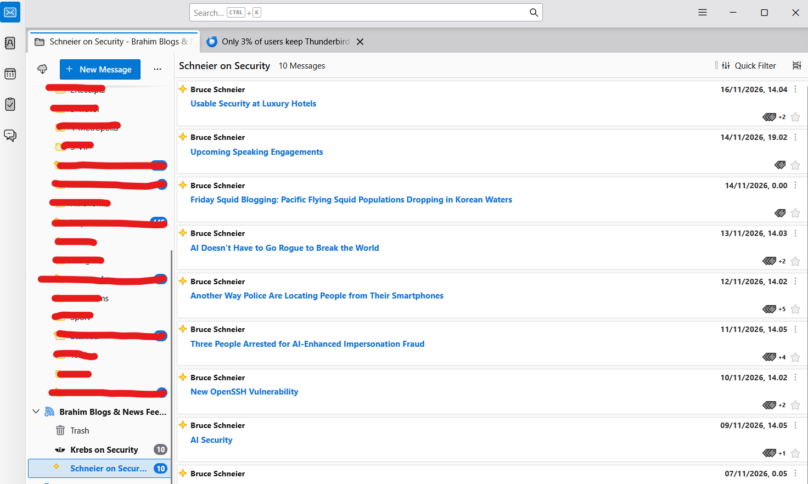

d\) Find and add two more security related feeds. Explain how you found them, and why you chose them:\
I went to google and searched with “Security related feed”. Then I chose Feedspot: https://rss.feedspot.com/information_security_rss_feeds/.

- 1- https://www.securityweek.com/feed/\
  I found it from google after I right-clicked the atom icon to copy the feed link.\
  \
  I chose SecurityWeek’s feed because it seems focusing on the practical, enterprise side of security: what’s being exploited, what to patch and what’s changing in the industry.

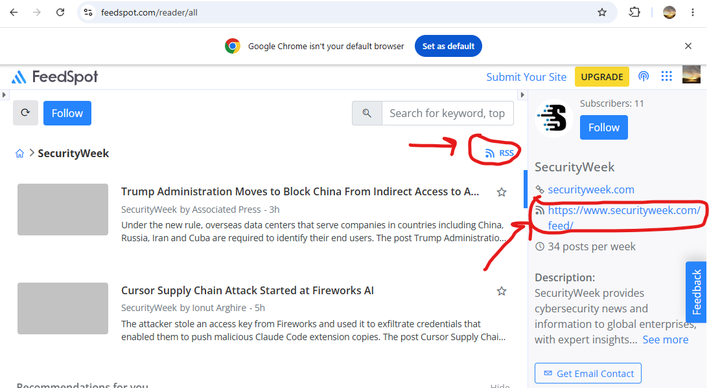

2- https://www.itsecurityguru.org/feed/\
I found it from google after I right-clicked the atom icon to copy the feed link.\
\
I chose this feed because it is a daily news digest of breaking security stories, so it saves me time from checking many sources. Its recent items cover breaches, government and regulatory news, threat intelligence, zero trust, open source vulnerabilities and vendor research, which is a good general awareness mix.\
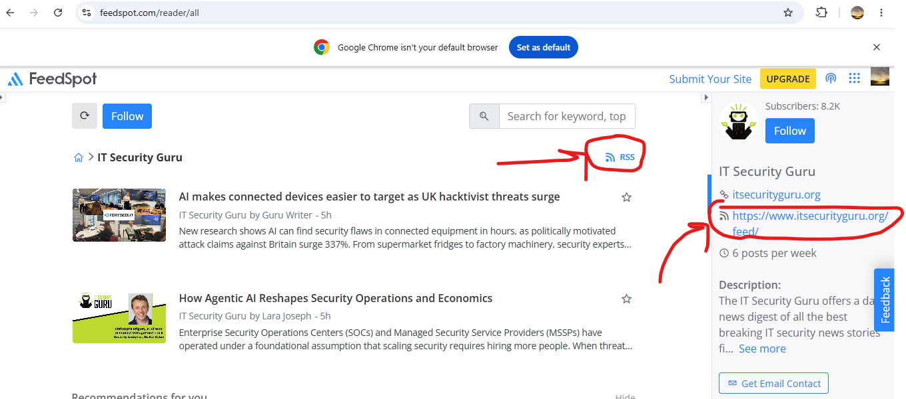

### Benefits of a feed reader

- **You control the sources.** There’s no algorithm, so you see everything from the sources you chose, in order.

- **Everything in one place.** You can mix news sites, vendor advisories, CISA alerts and researcher blogs, and add filters, keywords and folders.

- **Low noise and low distraction.** There are no ads, no engagement bait, and you read when you choose to.

- **Portable and private.** It’s an open standard, so you can switch readers without losing anything, and there’s little tracking.

> *Downsides of a feed reader*

- **Volume.** Feeds pile up, and unread counts turn into guilt. You need to prune and filter regularly.

f\) Port scan:\
How can criminals know what services your employer has?\
**Answer**:\
Criminals usually figure out *what services our employers are running* from information that's already public. This is called **reconnaissance**:

- **Job postings:** Ads like "Must know Salesforce, SAP and Microsoft 365" reveal exactly which systems a company uses.

- **LinkedIn profiles:** Employees list the tools they work with and their roles, which also shows who to target.

- **Company website and DNS records:** Public internet records show things like which email provider a company uses (for example Microsoft or Google) and its login pages.

- **Internet scanners:** Tools such as Shodan list servers that face the internet and the software running on them.

- **Social media and news:** Press releases like "We're moving to SAP S/4HANA!" or photos of office screens give away details.

With this information they write convincing phishing messages, such as a fake "Salesforce password reset" email sent to someone they know uses Salesforce.

**Reference: Claude AI prompted on 16.11.2026.**

**\**

### f-1) Install nmap port scanner on Linux Debian 13

> 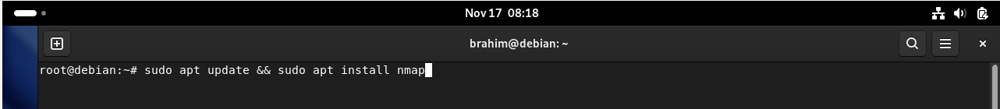**\
> \**
> 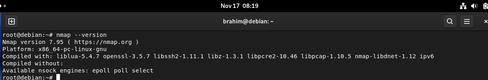
>
> f-2) Disconnect from the internet. Show that 'ping 8.8.8.8' stops working when internet is disconnected.**\**
> 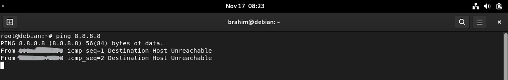**\
> \**

### f-3) Port scan my own computer using "localhost" as the address.

> 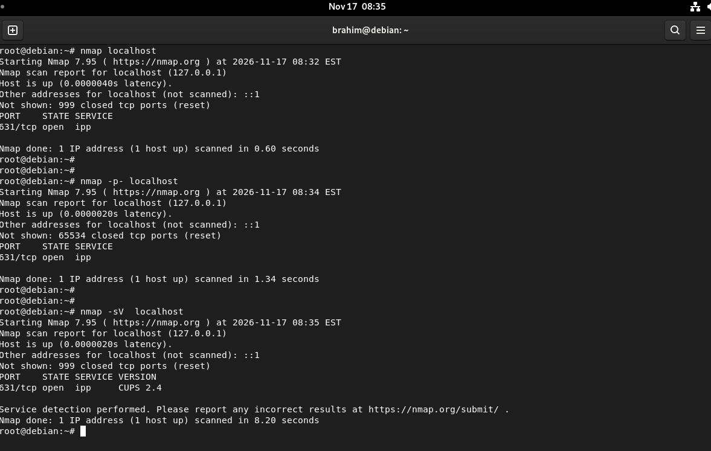**\
> \**
> 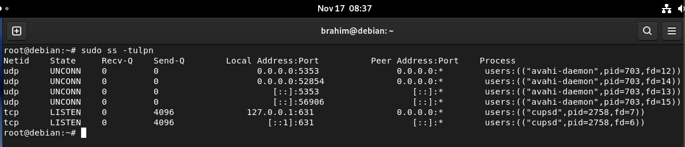**\**

### f-4) Install Apache web server (port 80) daemon

> 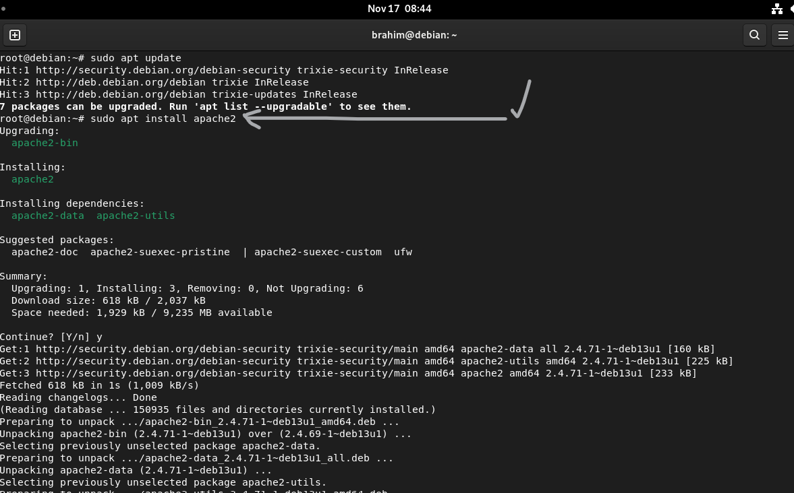
>
> 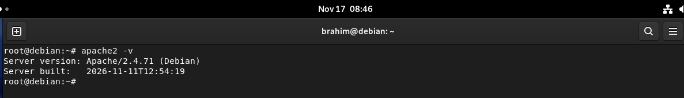
>
> f-5) Port Scan Again:**\**
> 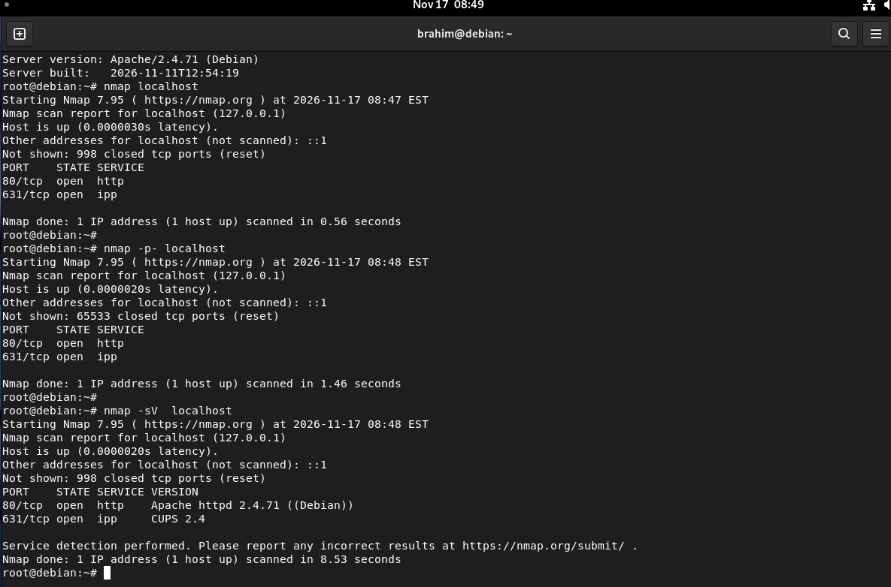
>
> 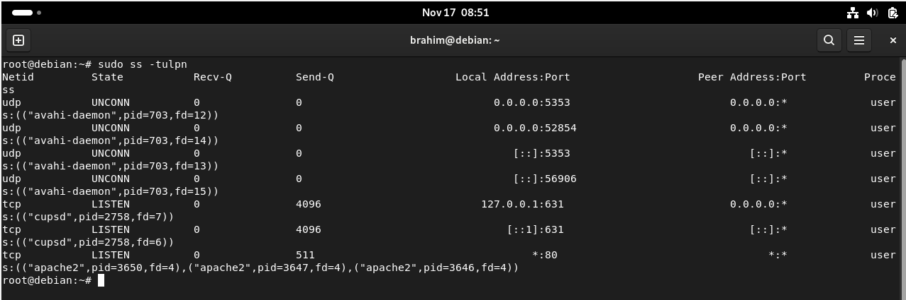
>
> f6) Analysis and results explanation:**\
> \**
> Before installing the Apache2 daemon the nmap scan showed 631/tcp open ipp
>
> After installing the Apache2 daemon: the nmap scan showed 80/tcp open http and 631/tcp open ipp
>
> Conclusion

- Installing apache2 automatically started a daemon that opened TCP port 80 and started listening for web requests.

- The rest of the system was not really affected. Avahi and CUPS kept the same ports and the same process IDs.

- In terms of security, the computer now has a new network-facing service, so its attack surface is larger. Before, the only TCP service was CUPS, which only localhost can reach. Now anyone on the local network can connect to port 80.
